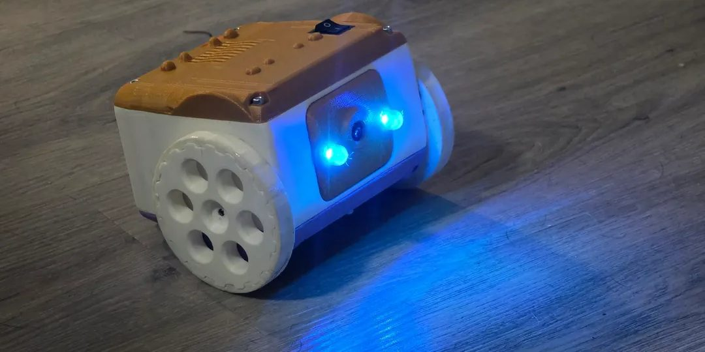
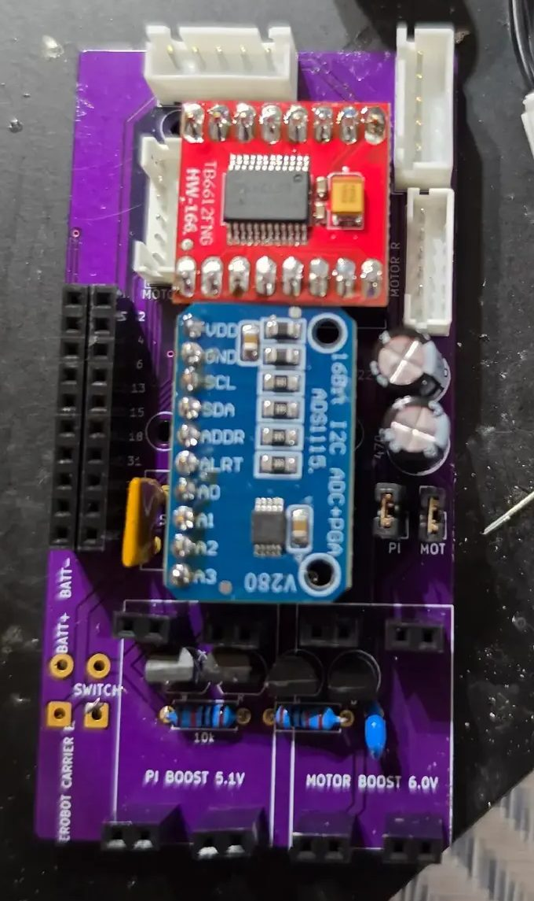
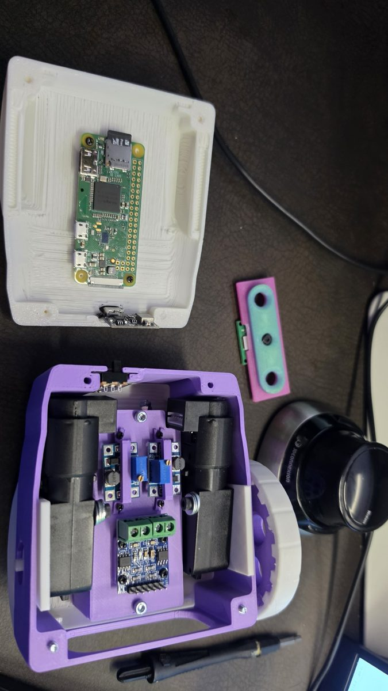
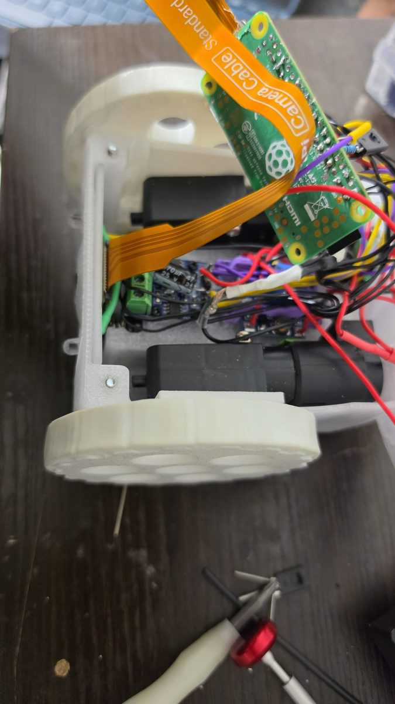
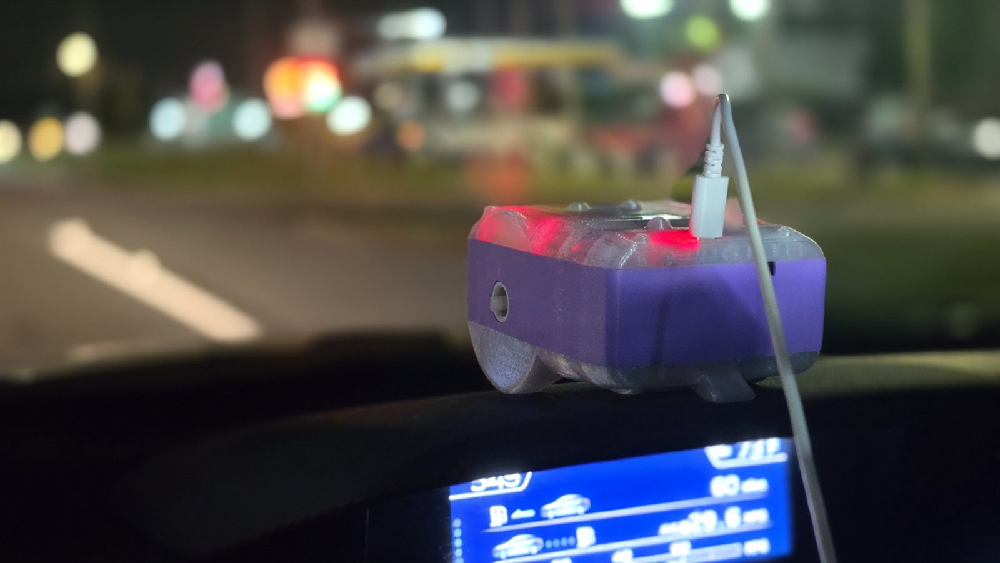
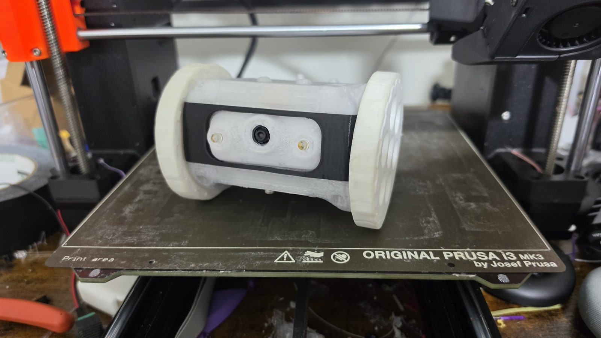

# Non-Zerobot

A small 3D-printed FPV robot you drive from your phone's web browser. It streams live video, has RGB headlights, and keeps itself driving straight using wheel encoders.

It started life as a Raspberry Pi Zero robot — hence the name. Pi Zeros got hard to find, so it now runs happily on a Pi 3B+ too. It's kind of a non-zero bot now.



> **Built on the shoulders of others.** This project is based on Max Kern's **ZeroBot** and **ZeroBot Pro**, and ZDV's **ZeroBot Pro V1** remix. See [CREDITS.md](CREDITS.md).

**Building one?** Go in this order: [parts list](BOM.md) → [assemble it](ASSEMBLY.md) → [install the software](INSTALL.md). Already have a robot? Jump straight to **[INSTALL.md](INSTALL.md)**.

---

## What it does

- **Drive from any phone** — Android or iPhone, nothing to install. Just open a web page.
- **Live video** from the Pi camera, with photo and video recording.
- **RGB headlights** with colour and brightness control.
- **Drives straight on its own** — the encoder motors let it balance left and right wheel speed automatically.
- **Built-in self-checks** — buttons to confirm motors and encoders are wired the right way round.
- **Looks after itself** — runs as a background service, restarts if it ever hangs, and shuts down safely on low battery.

## Supported hardware

| Part | Options |
|---|---|
| **Raspberry Pi** | Pi 3B+ (main build), Pi 3B, Pi 3A+, Pi Zero 2 W, Pi Zero W |
| **Camera** | Camera Module 3, OV5647 (cheaper), or the Pi AI Camera (used as a regular camera) |
| **Motors** | Hiwonder geared motors with hall-effect encoders |
| **Motor driver** | TB6612FNG board |
| **Battery** | Two 18650 cells in parallel, with a charger/5 V boost board for the Pi and a 6 V boost for the motors |
| **Battery meter** | ADS1115 ADC board |
| **Headlights** | 10 mm common-anode RGB LEDs |

A carrier circuit board that ties all of this together is in progress and will be added here once the current revision is proven.



## How it got here

| Pi Zero W | Pi Zero 2 W | Out for a drive |
|---|---|---|
|  |  |  |



## Getting started

- 🧾 **[BOM.md](BOM.md)**: every part, with part numbers and a DigiKey order list
- 🔧 **[ASSEMBLY.md](ASSEMBLY.md)**: build the robot step by step (🚧 in progress, not yet tested on a real build)
- 💾 **[INSTALL.md](INSTALL.md)**: install the software. No Linux experience needed
- 📦 **[Releases](https://github.com/MakerSteele/non-zerobot/releases)**: download just the robot software (`zerobot.zip`)

## Wiring (GPIO, BCM numbering)

| Function | GPIO |
|---|---|
| Left motor forward / backward | 17 / 27 |
| Right motor forward / backward | 22 / 23 |
| Encoders | 5, 13 (6, 19 wired for future use) |
| White headlight | 24 |
| RGB headlight red / green / blue | 12 / 16 / 26 |
| ADS1115 battery sense | I2C (GPIO 2 / 3) |

## Repo layout

```
zerobot/     the robot software - this whole folder goes on the Pi as ~/zerobot
docs/bom/    DigiKey order list and a kit cost calculator
docs/images/ photos
```

## License

- **Software** (everything in `zerobot/`): [GPL-3.0](LICENSE)
- **Documentation and images**: [CC BY-SA 4.0](LICENSE-DOCS.md)

Found a problem or have an idea? [Open an issue](https://github.com/MakerSteele/non-zerobot/issues).

Follow the build series: **@MakerSteele** on Instagram and TikTok.
