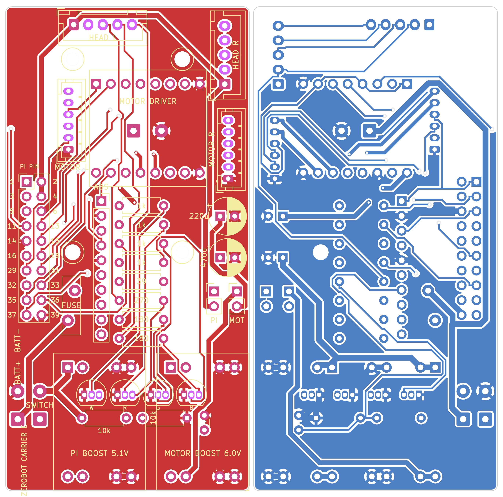

# Carrier board, Rev F (the board on the robot today)

This is the carrier board the original Non-Zerobot drives on. It's here so you can see exactly what's in the robot.

> ⚠️ **Don't order this board as it is.** It has two wiring faults (below). The robot only works because of hand fixes. **Rev G** fixes both, and its files will be added once a Rev G board has been built and tested.

## Files

| File | What it is |
|---|---|
| `zipme/` | Gerbers for JLCPCB (2 layers, 1.6 mm). **Zip the files inside this folder** and upload that zip |
| `kicad/` | KiCad project (made in KiCad 7; newer versions upgrade it) |
| `zerobot_carrier.step` | 3D model for CAD |
| `zerobot_carrier_schematic.pdf` | Schematic |
| `zerobot_carrier_1to1_fitcheck.pdf` | Print at 100 % and lay the modules on it |
| `scripts/` | The scripts that generate the board |

## Known issues

### 1. Boost footprints are mirrored (both boosts)
The two SX1308 boost footprints ("PI BOOST 5.1V" and "MOTOR BOOST 6.0V") were drawn from the board's label side, so they come out as mirror images. With a boost fitted parts-side up, the battery lands on the boost's **output** pin and nothing reaches its input, so the Pi gets no power.

**Fix on the original robot:**
- **Pi rail:** the Pi boost is removed. The 5 V output of the charger/boost combo board in the shell feeds the Pi side of the **Pi power jumper (JP1)**, with − to the carrier's battery − pad. This skips the rocker switch and the fuse, so pulling JP1 is the Pi's on/off.
- **Motor rail:** a boost set to 6.0 V, wired by hand to match its real pins. Running the motors straight off the battery also works (bridge the battery to the motor side of the **motor power jumper, JP2**), but they're noticeably weaker.

### 2. Motor sockets are reversed
The Hiwonder encoder-motor plug (G, H1, H2, V, M+, M−) lands end-for-end in the left and right motor sockets. With the plug in, the motor driver's output hits the encoder pins and the Pi's 3.3 V hits the motor. The motors don't turn, and **an encoder can be damaged**.

**Fix:** reverse the wire order inside both motor plugs (lift each crimp out of the housing and re-insert it at the other end) before plugging them in.

### 3. Battery + label is misleading
The **+** for the battery is printed nearest the ground pad, and the charger pads have no label. **+ is the square pad** on both.

### 4. Front mounting holes
The front pair of mounting holes sits over the battery-spring install holes. The main lower shell in [`models/`](../../models/) has its standoffs here, so it fits this board. Rev G moves these holes; its lower shell is in [`models/rev-g/`](../../models/rev-g/).

## Tip
The TB6612 motor-driver module goes in one way only: its **PWMA** pin row toward the front (headlight end), its **VM** row toward the rear, with PWMA and VM at the left (Pi-header) end. Fitted the other way round, it shorts the Pi's 3.3 V rail.

## License
Board files are shared under [CC BY-SA 4.0](../../LICENSE-DOCS.md), the same as the docs.
